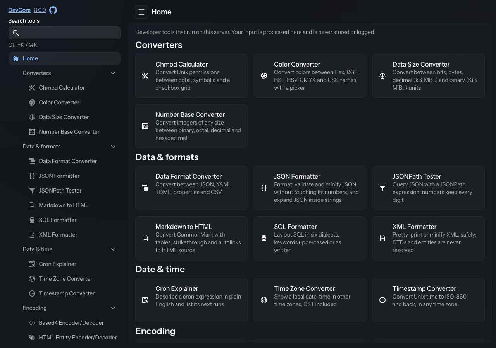

# DevCore

[](https://github.com/zeletrik/devcore/actions/workflows/release.yml)

A self-hosted developer toolbox: the everyday utilities you would otherwise paste into random websites, in one web app
that runs on your own machine or server. 42 tools in eight categories, built with Kotlin, Spring Boot and Vaadin. It
needs no account and no database, and makes no outbound calls.



## Tools

The **`input`** column says whether a deep link can pre-fill the tool (see [Deep links](#deep-links)). The
**`mode`** column lists the tool's modes, default first.

| Category       | Tool                                                      | Id                         | `input` | `mode`                                 |
|----------------|-----------------------------------------------------------|----------------------------|---------|----------------------------------------|
| Converters     | Chmod Calculator                                          | `chmod-calculator`         | yes     | —                                      |
| Converters     | Color Converter                                           | `color-converter`          | yes     | —                                      |
| Converters     | Data Size Converter                                       | `data-size-converter`      | yes     | —                                      |
| Converters     | Docker Compose Converter                                  | `docker-compose-converter` | —       | `to-compose`, `to-run`                 |
| Converters     | Number Base Converter                                     | `number-base-converter`    | yes     | —                                      |
| Data & formats | Data Format Converter (JSON, YAML, TOML, properties, CSV) | `data-format-converter`    | yes     | —                                      |
| Data & formats | JSON Diff                                                 | `json-diff`                | —       | —                                      |
| Data & formats | JSON Formatter                                            | `json-formatter`           | yes     | —                                      |
| Data & formats | JSONPath Tester                                           | `jsonpath-tester`          | yes     | —                                      |
| Data & formats | Markdown to HTML                                          | `markdown-to-html`         | yes     | —                                      |
| Data & formats | SQL Formatter                                             | `sql-formatter`            | yes     | —                                      |
| Data & formats | XML Formatter                                             | `xml-formatter`            | yes     | —                                      |
| Date & time    | Cron Explainer                                            | `cron-explainer`           | yes     | —                                      |
| Date & time    | Time Zone Converter                                       | `time-zone-converter`      | yes     | —                                      |
| Date & time    | Timestamp Converter                                       | `timestamp-converter`      | yes     | —                                      |
| Encoding       | Base64 Encoder/Decoder                                    | `base64`                   | yes     | `encode`, `decode`                     |
| Encoding       | HTML Entity Encoder/Decoder                               | `html-entities`            | yes     | `encode`, `decode`                     |
| Encoding       | Morse Code                                                | `morse-code`               | yes     | `encode`, `decode`                     |
| Encoding       | NATO Phonetic Alphabet                                    | `nato-alphabet`            | yes     | —                                      |
| Encoding       | String Escape/Unescape                                    | `string-escape`            | yes     | `encode` (escape), `decode` (unescape) |
| Encoding       | Unicode Escape                                            | `unicode-escape`           | yes     | `encode`, `decode`                     |
| Encoding       | URL Encoder/Decoder                                       | `url-encoder`              | yes     | `encode`, `decode`                     |
| Generators     | Barcode Generator                                         | `barcode-generator`        | yes     | —                                      |
| Generators     | Lorem Ipsum                                               | `lorem-ipsum-generator`    | —       | —                                      |
| Generators     | Password Generator                                        | `password-generator`       | —       | —                                      |
| Generators     | QR Code Generator                                         | `qr-code-generator`        | yes     | —                                      |
| Generators     | Random Number Generator                                   | `random-number-generator`  | —       | —                                      |
| Generators     | UUID Generator (v4, v7, ULID)                             | `uuid-generator`           | —       | —                                      |
| Network        | Random Port Generator                                     | `random-port-generator`    | —       | —                                      |
| Network        | Subnet Calculator                                         | `subnet-calculator`        | yes     | —                                      |
| Network        | URL Parser                                                | `url-parser`               | yes     | —                                      |
| Security       | Basic Auth Header                                         | `basic-auth`               | —       | `encode`, `decode`                     |
| Security       | Certificate Decoder                                       | `certificate-decoder`      | yes     | —                                      |
| Security       | Hash Generator (MD5, SHA-1, SHA-2, HMAC)                  | `hash-generator`           | yes     | —                                      |
| Security       | JWT Decoder/Encoder                                       | `jwt`                      | yes     | `decode`, `encode`                     |
| Security       | Key Pair Generator                                        | `key-pair-generator`       | —       | —                                      |
| Security       | Password Hashing (bcrypt, Argon2id)                       | `password-hashing`         | —       | `hash`, `verify`                       |
| Text           | Case Converter                                            | `case-converter`           | yes     | —                                      |
| Text           | Line Tools                                                | `line-tools`               | yes     | —                                      |
| Text           | Regex Tester (Java syntax)                                | `regex-tester`             | yes     | —                                      |
| Text           | Text Diff                                                 | `text-diff`                | —       | —                                      |
| Text           | Text Statistics                                           | `text-statistics`          | yes     | —                                      |

## Run it

**Docker**

```bash
docker run -p 8080:8080 ghcr.io/zeletrik/devcore:latest
```

**Docker Compose**: the repository's [`compose.yaml`](compose.yaml) runs the published image; `docker compose up`.

To build the image yourself:

```bash
./gradlew bootJar && docker build -t devcore .
```

**Java** (JDK 25; Gradle builds with the JDK in `JAVA_HOME` and doesn't detect or download one)

```bash
./gradlew bootJar
java -jar build/libs/devcore.jar
```

**Gradle**, for development with live reload:

```bash
./gradlew bootRun
```

An IDE that compiles on save reloads the app by itself. From a terminal, also run `./gradlew -t classes` in a second
terminal: it recompiles on every save, and the running app restarts with the change.

Then open <http://localhost:8080>. Health checks: `GET /actuator/health`.

## Configuration

| Environment variable | Default | Purpose |
|---|---|---|
| `SERVER_PORT` | `8080` | HTTP port |
| `SERVER_SERVLET_CONTEXT_PATH` | *(none)* | Serve everything under a path, e.g. `/devcore` |
| `SERVER_SERVLET_SESSION_COOKIE_SECURE` | `false` | Set to `true` when DevCore is reached over HTTPS (for example behind a TLS-terminating proxy), so the browser sends the session cookie over HTTPS only. |
| `DEVCORE_TOOLS_HIDDEN` | *(none)* | Comma-separated tool ids to hide, e.g. `lorem-ipsum-generator,nato-alphabet`. A hidden tool disappears from the sidebar, Home, search, favorites and recent tools, and its URL shows "Tool not found". |
| `DEVCORE_FAVORITES_DEFAULT` | *(none)* | Comma-separated tool ids to start as favorites in a browser that has no favorites yet, e.g. `json-formatter,base64`. Once someone changes their favorites, their own choice wins. |

Ids that DevCore doesn't know are ignored, with one warning per id in the startup log. Changes take effect on restart.

## Behind a reverse proxy

**Expose DevCore only through your proxy.** DevCore trusts the `X-Forwarded-*` headers it receives, so it shouldn't
also be reachable directly. With Docker Compose on the proxy's host, publish the port on loopback only
(`127.0.0.1:8080:8080`; [`compose.yaml`](compose.yaml) has the line ready).

**The proxy must overwrite the `X-Forwarded-*` headers, not append to them.** Otherwise a client can send its own
`X-Forwarded-Host` or `X-Forwarded-Prefix` and change the links and redirects DevCore builds. nginx's
`proxy_set_header` replaces a header. Traefik replaces them unless you trust the client with `forwardedHeaders.insecure`
or `forwardedHeaders.trustedIPs`.

If users reach DevCore over HTTPS, set `SERVER_SERVLET_SESSION_COOKIE_SECURE=true`.

**Same path on both sides**: forward `/devcore/` unchanged and set `SERVER_SERVLET_CONTEXT_PATH=/devcore`.

**Path-stripping proxy**: DevCore stays at `/` and the proxy sends the removed prefix in `X-Forwarded-Prefix`.

nginx:

```nginx
location = /devcore { return 301 /devcore/; }

location /devcore/ {
    proxy_pass http://127.0.0.1:8080/;          # the trailing slash strips /devcore
    proxy_set_header Host               $host;
    proxy_set_header X-Forwarded-Proto  $scheme;
    proxy_set_header X-Forwarded-Host   $host;
    proxy_set_header X-Forwarded-Prefix /devcore;
}
```

Traefik (Docker labels). The `RedirectRegex` middleware sends `/devcore` to `/devcore/`, and the `StripPrefix`
middleware sets `X-Forwarded-Prefix` itself. In Compose labels, `$$` stands for a literal `$`:

```yaml
services:
  devcore:
    image: ghcr.io/zeletrik/devcore:latest
    labels:
      - traefik.enable=true
      - traefik.http.routers.devcore.rule=PathPrefix(`/devcore`)
      - traefik.http.routers.devcore.middlewares=devcore-slash,devcore-strip
      - traefik.http.middlewares.devcore-slash.redirectregex.regex=^(https?://[^/]+/devcore)$$
      - traefik.http.middlewares.devcore-slash.redirectregex.replacement=$${1}/
      - traefik.http.middlewares.devcore-slash.redirectregex.permanent=true
      - traefik.http.middlewares.devcore-strip.stripprefix.prefixes=/devcore
      - traefik.http.services.devcore.loadbalancer.server.port=8080
```

**Adding a login.** DevCore has none. Put **forward authentication** in front of it at the proxy with Authelia,
Authentik or oauth2-proxy. In nginx that is `auth_request` pointing at the auth service. In Traefik it is a
`forwardAuth` middleware added to the router's `middlewares`. DevCore itself never talks to the identity provider.

**Dashboards** on the same site (for example `http://homelab.local:3000` embedding `http://homelab.local:8080`) can
show DevCore tools in an iframe. Cross-site embedding isn't supported.

## Deep links

Every tool has a stable URL: `/<id>`. Tools marked **yes** in the `input` column accept `?input=` to pre-fill their main
input. Tools with modes accept `?mode=` with one of the names in the `mode` column; any other value selects the
default. Parameters are URL-encoded like any query string, and every other parameter is ignored. Passwords, secrets
and keys are never read from a URL.

> [!WARNING]
> **A token in a link is a credential.** A JWT or any other secret in `?input=` ends up in browser history and in
> every proxy access log the request passes through. Treat such a link like the secret itself, and don't share it or
> paste it into chat. For this reason the Basic Auth Header tool ignores `?input=` in both modes.

```
http://localhost:8080/base64?mode=decode&input=aGVsbG8%3D
http://localhost:8080/jwt?input=eyJhbGciOi...
http://localhost:8080/subnet-calculator?input=10.0.0.0%2F24
```

This makes DevCore easy to drive from Raycast quicklinks, browser keyword searches or `open <url>` in a terminal.
Favorites (the star in a tool's header) and the recently used tools on Home are kept per browser in cookies, as tool
ids only.

## Privacy and trust model

- **Your input is processed on the DevCore server**, not in the browser. It stays in memory for your session and is
  never stored or logged, but it does travel to wherever DevCore is hosted. Host it yourself.
- **Keys, passwords and hashes are generated on the DevCore server** too: the key pairs, passwords, passphrases and
  bcrypt/Argon2 hashes you create there.
- **There is no login.** Anyone who can reach the URL can use every tool. Run DevCore on a private network, or behind a
  reverse proxy that handles authentication (see above).
- **A token in a link is a credential.** A `?input=` value ends up in browser history and in every proxy access log.
  A link with a JWT or another secret in it is as sensitive as the secret: don't put secrets in links you share or
  bookmark.
- **The browser only talks to DevCore.** A Content-Security-Policy limits pages to loading from and connecting to
  DevCore's own origin, and the server makes no outbound calls. Nothing in a certificate (OCSP, CRL, issuer URLs) is
  fetched, and no host name is ever looked up.
- Copy-to-clipboard works over plain HTTP too, with a fallback for browsers that only allow the modern clipboard API on
  HTTPS.

## Third-party

DevCore bundles open-source libraries, each under its own license. [`NOTICE`](NOTICE) holds the attributions, and the
jar carries it under `META-INF/devcore/` together with the Apache License 2.0 text, the upstream NOTICE files of the
bundled libraries and a list of every library with its version and license. The About page (`/about`) shows the same
list.

Bundled data:
- The Password Generator's passphrases use the [EFF large word list](https://www.eff.org/dice) by the Electronic
  Frontier Foundation, licensed under [CC BY 3.0 US](https://creativecommons.org/licenses/by/3.0/us/).
- The Color Converter's CSS color names come from [color-name](https://github.com/colorjs/color-name) (MIT).
- The GitHub mark in the header is from [Octicons](https://github.com/primer/octicons) (MIT).

## Development

`./gradlew test detekt` runs the same checks as CI. Commit messages follow
[Conventional Commits](https://www.conventionalcommits.org) (`fix:`, `feat:`, `feat!:` or a `BREAKING CHANGE:` footer),
because they decide the next version. [`CONTRIBUTING.md`](CONTRIBUTING.md) has the details, including how to add a
tool. Report vulnerabilities privately, as [`SECURITY.md`](SECURITY.md) describes.

## Releasing (maintainers)

Releases are automatic. Every pull request runs the tests and Detekt. Every push to `main` runs them too, and then
[semantic-release](https://semantic-release.gitbook.io) reads the commits since the last release. If one is due, it:
- bumps `version` in `gradle.properties`;
- adds the release notes to `CHANGELOG.md`, which the About page shows;
- tags `vX.Y.Z` and writes the GitHub release notes;
- publishes a `linux/amd64` + `linux/arm64` image to `ghcr.io/zeletrik/devcore`, tagged `X.Y.Z` and `latest`.

`fix:` gives a patch release, `feat:` a minor one, and a breaking change a major one. The first release is `1.0.0`.
After the first publish, check that the package's visibility is **public** in its GitHub package settings. In the
repository's security settings, turn on **private vulnerability reporting** (the security policy relies on it) and
Dependabot alerts; `.github/dependabot.yml` already schedules weekly version updates for actions, Gradle and the base
image.

## License

[MIT](LICENSE)
